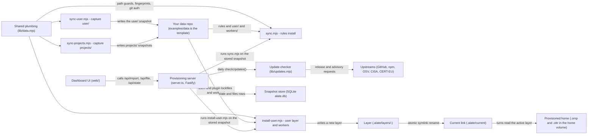
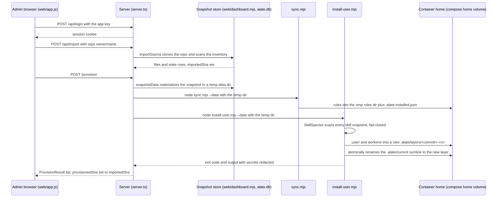
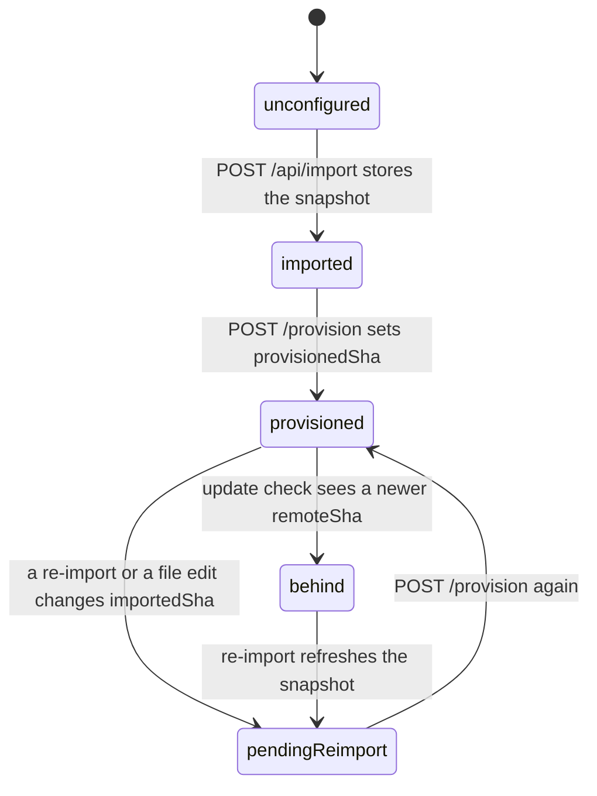

# How alate works

alate provisions an [omp](https://github.com/can1357/oh-my-pi) agent on any machine: global agent rules, the omp user layer, and per-project agent-context snapshots. alate ships no content of its own. All content lives in a private data repo of yours; `examples/data/` is the starter template. Two parts do the work:

- **CLI scripts** run on a machine: `sync.mjs` and `install-user.mjs` install from the data repo; `sync-user.mjs` and `sync-projects.mjs` capture machine state into it.
- **A provisioning server** (`server.ts`, Fastify) stores a snapshot of the data repo in SQLite, runs the install scripts against it, and serves a web dashboard (`web/`) for import, edits, and update checks.

Run the server with `docker compose up -d` (image `ghcr.io/ottr-ai/alate`) or `node server.ts` (Node type stripping, no build step). The default bind is `127.0.0.1:4570`.

## Architecture

- **Data repo** — `examples/data/` (starter template; layout documented in README "Data repo layout"): root `*.md` rules, `user/` home snapshot, `projects/projects.json` + `projects/<name>/`, `workers/<project>/` + `workers/_all/`, `upstreams.json`.
- **Shared plumbing** — `lib/data.mjs`: `resolveDataDir` (`--data <dir>` | `--repo <owner/name[@ref]>` | `$ALATE_DATA` | `../agent-data`; the repo form also accepts `<host>/owner/name[@ref]` for a GitHub Enterprise Cloud tenant or Enterprise Server host, or a full `https://` URL), arg parsing, content fingerprints, Windows-to-Linux config adaptation (`forTarget`), path guards (`checkDestination`, `assertSourceInside`, `safeRel`), git auth (`gitAuthEnv`, `cloneCommand`), GitHub host helpers (parsing `github.com` by default, `ALATE_GITHUB_HOST` as the ambient default, and the API base mapping: `github.com` → `api.github.com`, `*.ghe.com` → `api.<host>`, other hosts → `<host>/api/v3`), secret redaction, the fail-closed `yamlProblems` scanner.
- **sync.mjs** — installs data-repo root rules into the omp rules dir (`$PI_CODING_AGENT_DIR/rules`, else `~/.omp/agent/rules`); hidden-character scan, `upstreams.json` origin gate, install manifest `target/.alate-installed.json`, deletes dropped rules that nobody edited.
- **install-user.mjs** — restores `user/` onto the home (`~/.alate/installed.json` manifest; refuses changed files without `--force`); applies sync.mjs's hidden-character gate to every `*.md`/`*.mdc` in the snapshot (agent context such as `AGENTS.md` loads as always-on instructions too) and the frontmatter-description rule gate to `omp/agent/rules/`; scans every skill snapshot with a pinned SkillSpector build (`SKILLSPECTOR_REF`, fail-closed); installs plugins with `bun install --frozen-lockfile`; provisions `workers/` additions to `~/.ottr/workers/<project>/`. With `ALATE_LAYER=1` or `--layer`, it installs into a fresh `.alate/layers/<commit>-<n>` folder and switches the `.alate/current` symlink by one atomic rename; a failure before the switch deletes the fresh layer and leaves current unchanged, and the first layer over an in-place home takes the machine part of `config.yml` from the home.
- **sync-user.mjs** — captures an allowlist of home items into `user/`; a missing item is `not present`, never an error, and a home with nothing present captures nothing; refuses credential-shaped values and secret-named keys that hold literals; drops deployment blocks (`hindsight:`/`alate:`) from `config.yml`.
- **sync-projects.mjs** — copies each project's context files (per `projects/projects.json`) into `projects/<name>/`.
- **License gate** — `license-gate.mjs`: fails when a `package-lock.json` entry has a missing or non-allowlisted `license` field (SPDX expressions split on AND/OR/WITH).
- **Provisioning server** — `server.ts`: key-authenticated API, snapshot store, dashboard host. Tables `state` and `files` (created in `server.ts`); update tables from `lib/updates.mjs` (`initUpdates`). Config in `server-config.json`; first start prints the API key.
- **Snapshot store** — `alate.db` (SQLite via `node:sqlite`): `files` holds every data-repo file; `state` holds dashboard state; `updates`, `update_seen`, `osv_cache` hold update-check state.
- **Dashboard core** — `web/dashboard.mjs` (transport-free): `importSource` (clone or local import into SQLite), `snapshotData` (materialize the snapshot to a temp dir), `applyFileEdit` (base-hash-checked writes that commit and push), inventory scan.
- **Browser UI** — `web/index.html` shell, `web/app.js` client (overview, file index, editor with proof marks, updates, settings), `web/style.css` (Galley Proof theme), `web/diff.mjs` (line diff), `web/sw.js` (network-first offline shell), `web/manifest.webmanifest` + `web/icons/` (installable PWA), self-hosted fonts served from `node_modules` at `/fonts/`.
- **Update checker** — `lib/updates.mjs`: one record per `upstreams.json` item; tiered age gates (7 days, or 2 days for a CVE-claiming release, or 0 days when OSV/CISA/CERT-EU corroborate); sources: GitHub releases, npm registry, nodejs.org, chrome-for-testing, OSV, CISA RSS, CERT-EU. A path or branch row counts its 7 days from the checker's first sight of the head commit, so every new commit restarts the wait.
- **Provisioned home** — the compose `home` volume (`compose.yaml`, `Dockerfile`); the image carries the pinned SkillSpector build.
- **CI** — `.github/workflows/install.yml` (fresh install from `examples/data`), `.github/workflows/sync.yml` (self-check chain), `.github/workflows/release.yml` (image to ghcr.io on a release).

## Main use case: provision a fresh machine

The prepared flow: capture with `sync-user.mjs` once on the machine that already runs omp, then import and provision from the dashboard.

- **Admin browser** — `web/app.js` (`api()` helper, login view, source form); `POST /api/login` exchanges the key for a session cookie because phones cannot set headers.
- **Server** — `server.ts`: `provision()` materializes the snapshot, spawns each script in `SCRIPTS` and stops at the first nonzero or null exit code, so the result list holds only the scripts that ran; caps and redacts output; auth: Bearer key always, dashboard routes key-free on a loopback bind only, and a loopback write also needs a same-origin `Origin` header or a same-host `Referer` (`dashGuard`). A loopback bind also refuses non-loopback `Host` headers (DNS rebinding).
- **Snapshot store** — `web/dashboard.mjs`: `importSource`, `snapshotData`, `applyFileEdit`; SQLite tables in `server.ts` and `lib/updates.mjs`.
- **sync.mjs / install-user.mjs** — the same CLI scripts a host runs by hand; the server passes `--data <temp snapshot dir>`.
- **Container home** — `compose.yaml` volume `home` mounted at `/root`; `state` volume holds `server-config.json` and `alate.db`. A turn resolves `.alate/current` once at its start and keeps that layer for its whole life.

## Life cycle of the stored snapshot

The server tracks two commits: `importedSha` (what the snapshot holds) and `provisionedSha` (what the home was built from), plus the `remoteSha` the update check sees. Names come from `server.ts` (`Config.update`, `dashState.source`).

- **unconfigured** — fresh server, `dashState.source` null (`server.ts` startup); `/health` reports it.
- **imported** — `POST /api/import` (`importSource`, `web/dashboard.mjs`) stored the snapshot; `importedSha` set.
- **provisioned** — `POST /provision` succeeded; `server.ts` sets `config.update.provisionedSha = importedSha`.
- **pendingReimport** — `importedSha` differs from `provisionedSha` (`pending` in the `/health` payload); an edit through `PUT /api/file` or a re-import lands here.
- **behind** — `dashCheck`/`updateCheck` saw a newer `remoteSha` (`available` flag in `/api/updates`); with `autoUpdate` enabled, `dashCheck` re-imports on its own, which makes the snapshot `pendingReimport`.

## Limits

Read at the level of structure and control flow: the script bodies, `server.ts`, `lib/data.mjs`, `lib/updates.mjs`, `web/dashboard.mjs`, `web/sw.js`, `web/diff.mjs`, and the section layout of `web/app.js`. Not read: the test files (`*.test.mjs`), the full text of `web/style.css`, the icon assets, `tsconfig.json`, and the full body text of the CI workflow files beyond their headers.
